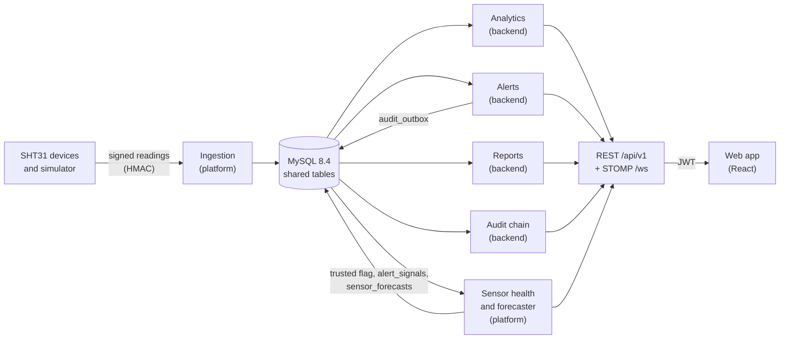

# Corrosion Watch

[](https://github.com/CS5010-team-404/corrosion-monitor/actions/workflows/ci.yml?query=branch%3Adev)

Corrosion Watch warns people before moisture damages electronic equipment. When warm, humid air meets a cooler surface,
water condenses on circuit boards and connectors and, over time, causes corrosion and failures that are expensive and
hard to trace. The system collects temperature and humidity readings from sensors (simulated SHT31 sensors, or an
optional Raspberry Pi with a real SHT31), checks that each sensor can be trusted, calculates the dew point, the
condensation margin and a corrosion risk index for every piece of equipment, forecasts the margin 15 to 60 minutes
ahead, and raises warning and critical alerts that escalate to a manager if nobody responds. Managers export reports
as CSV or PDF, administrators manage users, devices and equipment profiles, and every important action is written to a
tamper-evident audit log.

**Live demo:** https://corrosion-watch-web.onrender.com

The detailed Phase 2 write-up is in [Phase2_README.md](Phase2_README.md).

## Contents

1. [Team](#team)
2. [Repository Structure](#repository-structure) (with [How it works](#how-it-works))
3. [Setup and Run](#setup-and-run) (with [Try it end to end](#try-it-end-to-end))
4. [Feature Status](#feature-status)
5. [Scope and Design Changes Since Phase 1](#scope-and-design-changes-since-phase-1)
6. [Design Patterns and Principles Applied](#design-patterns-and-principles-applied)
7. [Testing](#testing)
8. [Known Issues](#known-issues)
9. [Team Contributions (Phase 3)](#team-contributions-phase-3)
10. [Development Workflow](#development-workflow)
11. [Deployment](#deployment)
12. [Documentation](#documentation)
13. [Notes](#notes)

## Team

| Member           | GitHub Username                                    | Role                                                                                  |
|------------------|----------------------------------------------------|---------------------------------------------------------------------------------------|
| Aayushee Bhat    | [@aayushee-bhat](https://github.com/aayushee-bhat) | Analytics: dew point margin, corrosion risk, equipment status                         |
| Anela Quiroz     | [@anelajoy](https://github.com/anelajoy)           | Audit: hash-chained audit log and verification; equipment-profile API                 |
| Dumebi Onyebuchi | [@dumebi2003](https://github.com/dumebi2003)       | Alerts: alert lifecycle, escalation, corrective actions; reports                      |
| Joshua Dominick  | [@Joshuadommy](https://github.com/Joshuadommy)     | Data platform (ingestion, sensor health, simulator, forecaster), sign-in and user administration, frontend, deployment |

## Repository Structure

```
corrosion-monitor/
├── backend/                          Team backend: Spring Boot 3.4.1, Java 17
│   └── src/main/java/com/team404/corrosion/
│       ├── auth/                     Sign-in, lockout, JWT, demo users; auth/admin/: user administration
│       ├── analytics/                Equipment status: dew point, margin, risk level (analytics/risk/: Peck index, time of wetness)
│       ├── alert/                    signal/ (consumer), lifecycle/ (REST, escalation, email), calculation/ (dew point)
│       ├── report/                   Report summary, CSV and PDF export (FR7)
│       ├── profile/                  Equipment-profile API with validation (FR8)
│       ├── audit/                    Hash-chain worker, verification, checkpoints, audit API
│       ├── web/                      Security rules, error responses, WebSocket (/ws)
│       └── tools/                    Runs the Flyway migrations on their own (scripts/check-aiven.sh)
│   └── src/main/resources/db/migration/   Flyway migrations V1–V9 (the team schema)
├── platform/                         Data platform, its own Maven build and service
│   ├── ecp-common/                   Dew point maths, HMAC signing, signal and audit publishers, GuardedJob
│   ├── ecp-simulator/                Simulated SHT31 sensors, 10 scenarios
│   ├── ecp-forecast/                 Condensation forecaster (ML model, trainer)
│   ├── ecp-ingestion/                Signed device ingestion API
│   ├── ecp-health/                   Sensor health rules and API
│   └── ecp-platform-app/             Runnable service: security, device registry, simulator, forecast API and
│                                     publishing; its own Flyway history in src/main/resources/db/platform (V1–V2)
├── frontend/                         React 18 + TypeScript web app (8 pages, built-in mock backend)
├── simulator/                        Original Phase 1 Java simulator (still in the root build; superseded by platform/ecp-simulator)
├── devices/raspberry-pi/             Optional real-sensor client
├── db/schema.sql                     Kept for reference only; Flyway creates the schema
├── deploy/platform.Dockerfile        Container image for the platform
├── scripts/                          Run, stop, smoke-test, coverage, Aiven check and model-training scripts
├── docs/                             Architecture, contracts, decisions, gaps, deployment, demo (see Documentation)
├── .github/workflows/                CI: ci.yml (backend), platform.yml, frontend.yml
├── docker-compose.yml                Local MySQL 8.4 (production SQL settings) and MailHog
├── docker-compose.platform.yml       The above plus the platform service
├── render.yaml                       Render deployment blueprint
└── pom.xml                           Parent Maven build (backend and simulator)
```

Inside the backend, each area is layered the same way: **controllers** (REST) call **services** (rules and
transactions), which call **repositories** (JDBC, or JPA for users). For example, `AlertController` →
`AlertService` → `JdbcAlertStore`, and `ReportController` → `ReportService` → `ReportRepository`. The maths and rules
(dew point, Peck risk, time of wetness, alert states, hash chain, report figures, profile validation) are plain Java
with unit tests.

### How it works



The system has the two parts from the Phase 1 design. The **data platform** (`platform/`) receives and checks sensor
data and forecasts condensation. The **team backend** (`backend/`) holds sign-in, user administration, analytics,
alerts, reports, equipment profiles and audit. Both use one MySQL database. Key design choices:

- **Services meet only through shared tables** ([docs/CONTRACTS.md](docs/CONTRACTS.md)). Neither calls the other.
- **Untrusted sensors are skipped.** Sensor health checks 7 rules (offline, stuck, out of range, erratic, losing
  readings, bad signatures, clock skew) and sets `sensor_health.trusted`. Analytics only uses readings from trusted
  sensors.
- **Signals instead of direct calls.** Producers write a RAISED or CLEARED row to `alert_signals`, and the alert
  service turns those into alerts.
- **A tamper-evident audit chain.** Events go to `audit_outbox` in the same transaction as the change they record.
  The audit worker chains them into `audit_log` with SHA-256, so editing, deleting or reordering any entry is detected.
- **One sign-in token for both services.** The backend issues a JWT that the platform also accepts.

[docs/ARCHITECTURE.md](docs/ARCHITECTURE.md) has the full picture.

## Setup and Run

### Prerequisites

| Tool                 | Version                                    |
|----------------------|--------------------------------------------|
| JDK                  | 17 (what CI uses)                          |
| Maven                | 3.9                                        |
| Docker Desktop       | with Docker Compose v2                     |
| Node.js and npm      | Node 20 or newer (CI uses 22)              |
| Git                  | any recent version                         |

### One command

```bash
git clone https://github.com/CS5010-team-404/corrosion-monitor.git
cd corrosion-monitor
scripts/run-local.sh
```

This builds the jars if needed and starts:

| What                                    | Where                 |
|-----------------------------------------|-----------------------|
| MySQL 8.4 (Docker, production SQL mode) | `localhost:3306`      |
| Team backend                            | http://localhost:8080 |
| Data platform (with the simulator)      | http://localhost:8081 |
| Web app                                 | http://localhost:5173 |

It creates `.env.local` (ignored by git) with a local JWT secret and the demo password, and prints the demo emails.
Use `REBUILD=1 scripts/run-local.sh` after code changes. Stop everything with:

```bash
scripts/stop-local.sh            # keeps the database; `docker compose down -v` wipes it
```

### Manual path

```bash
cp .env.example .env                        # local database passwords; never commit .env
docker compose up -d                        # MySQL on 3306, MailHog inbox on http://localhost:8025

# Backend on :8080 (Flyway creates the schema on startup)
export MYSQL_USER=app_rw MYSQL_PASSWORD=change-me-app    # the values in your .env
export ECP_JWT_SECRET="$(openssl rand -base64 48)"       # required, at least 32 bytes
export ECP_DEMO_PASSWORD='choose-a-demo-password'        # password for the four demo users
mvn -B -pl backend -am -DskipTests package
java -jar backend/target/backend-0.1.0-SNAPSHOT.jar

# Data platform on :8081, in a second terminal (local mode, sign-in check off)
docker compose -f docker-compose.platform.yml up --build

# Web app on :5173, in a third terminal (proxies to :8080 and :8081)
cd frontend && npm install && npm run dev
```

### No Java: mock mode

```bash
cd frontend && npm install && npm run dev:mock
```

The whole UI runs on a built-in mock backend at http://localhost:5173. Sign in with a demo email and any password.

### Demo accounts

There is one account per role: `tech@corrosionwatch.app` (Technician), `operator@corrosionwatch.app` (Operator),
`manager@corrosionwatch.app` (Manager) and `admin@corrosionwatch.app` (Admin). Locally, the password is
`ECP_DEMO_PASSWORD` (`scripts/run-local.sh` puts it in `.env.local`). The live demo password is shared privately
with the instructor.

### Environment variables

Names and purpose only; never commit real values. `scripts/gen-secrets.sh` prints fresh values.

| Variable                                                      | Used by   | Purpose                                                                  |
|---------------------------------------------------------------|-----------|--------------------------------------------------------------------------|
| `MYSQL_ROOT_PASSWORD`                                         | Docker    | Root password of the local MySQL container                               |
| `MYSQL_USER`, `MYSQL_PASSWORD`                                | Backend   | Database account (`app_rw` locally)                                      |
| `DB_URL`, `DB_POOL`                                           | Backend   | JDBC URL (defaults to the local database) and connection pool size       |
| `ECP_JWT_SECRET`                                              | Both      | Signs and checks sign-in tokens; at least 32 bytes, same value on both   |
| `ECP_DEMO_PASSWORD`, `ECP_DEMO_SEED`                          | Both      | Password for the demo users; `ECP_DEMO_SEED=false` turns demo data off   |
| `ECP_ALERTS_*`                                                | Backend   | Alert timings and switches, e.g. `ECP_ALERTS_SCHEDULER_ENABLED=false`    |
| `SPRING_MAIL_HOST`, `SPRING_MAIL_PORT`, `SPRING_MAIL_USERNAME`, `SPRING_MAIL_PASSWORD`, `ECP_ALERTS_MAIL_FROM` | Backend | SMTP for escalation email (MailHog locally; [docs/DEPLOYMENT.md](docs/DEPLOYMENT.md) section 6) |
| `PORT`                                                        | Both      | HTTP port (8080 backend, 8081 platform)                                  |
| `ECP_DB_URL`, `ECP_DB_USER`, `ECP_DB_PASSWORD`, `ECP_DB_POOL` | Platform  | Database connection                                                      |
| `ECP_PLATFORM_AUTH`                                           | Platform  | `jwt` (default) or `none` (local only)                                   |
| `ECP_SECRET_KEY`, `ECP_SECRET_SALT`                           | Platform  | Encrypt the device keys stored in the database                           |
| `ECP_SIMULATOR_ENABLED`, `ECP_SIMULATOR_SPEED`                | Platform  | Run the built-in simulator, and how fast its scenarios move              |
| `ECP_RETENTION_DAYS`                                          | Platform  | How long readings are kept                                               |
| `SENSOR_SECRET`                                               | Simulator | Signing key for the original simulator module                            |
| `VITE_API_URL`, `VITE_PLATFORM_URL`                           | Web app   | Service URLs for a deployed build (empty locally: the dev proxy is used) |
| `VITE_USE_MOCKS`, `VITE_BACKEND_LIVE`, `VITE_MOCK_FALLBACK`   | Web app   | Mock mode, live alert updates, sample data for missing endpoints         |

### Run the tests

```bash
mvn -B verify                                     # backend (Docker must be running for the MySQL tests)
mvn -B -f platform/pom.xml verify                 # data platform
cd frontend && npm run lint && npm run test:coverage && npm run build
```

Results and coverage are in [Testing](#testing).

### Try it end to end

#### A failing sensor becomes an alert, a technician resolves it, the audit log records it

On the live demo (or locally after `scripts/run-local.sh`):

1. Sign in as `admin@corrosionwatch.app`.
2. Open **Administration → Simulator** and set **SIM-010** to **Silent**. The sensor stops sending readings.
3. Open **Alerts** and wait. After about 90 seconds (6 missed 15-second readings) sensor health marks SIM-010
   offline and untrusted, and a critical "Sensor offline: SIM-010" alert appears. The bell shows a dot, without a
   page reload.
4. Sign out and sign in as `tech@corrosionwatch.app`. Open the alert, click **Acknowledge**, log a corrective action
   with a note, then click **Resolve**. Each step appears in the alert's timeline.
5. Sign in as `manager@corrosionwatch.app` (or admin) and open **Audit log**. The alert's events are listed:
   opened, acknowledged, corrective action logged, resolved. **Verify chain** confirms the chain is intact.
6. Still as manager, open **Reports**, pick today, and download the CSV or PDF: the alert is counted, with the time
   to acknowledge and the corrective action.
7. As admin, set SIM-010 back to **Normal**.

If a page looks out of date after a new deployment, reload it without the cache (Cmd+Shift+R, or Ctrl+Shift+R).

#### Sign-in and lockout

Try this locally, so the shared demo accounts are not locked. With `scripts/run-local.sh` running:

```bash
P="$(grep '^ECP_DEMO_PASSWORD=' .env.local | cut -d= -f2-)"
# 1. Correct password: 200 with a token, the role and an expiry time
curl -s -H 'Content-Type: application/json' -d "{\"email\":\"tech@corrosionwatch.app\",\"password\":\"$P\"}" \
  http://localhost:8080/api/v1/auth/login
# 2. Five wrong passwords: 401 "Incorrect email or password." four times, then 423 "Account locked ..."
for i in 1 2 3 4 5; do curl -s -o /dev/null -w '%{http_code}\n' -H 'Content-Type: application/json' \
  -d '{"email":"tech@corrosionwatch.app","password":"wrong"}' http://localhost:8080/api/v1/auth/login; done
# 3. The correct password is now refused too (423) until 15 minutes have passed
curl -s -o /dev/null -w '%{http_code}\n' -H 'Content-Type: application/json' \
  -d "{\"email\":\"tech@corrosionwatch.app\",\"password\":\"$P\"}" http://localhost:8080/api/v1/auth/login
```

The sign-in successes, failures and the lockout appear in the Audit log, with no passwords in them. An admin can
unlock the account straight away in **Administration → Users**; the unlock is audited as `ACCOUNT_UNLOCKED`.

## Feature Status

The functional requirements as worded in Phase 1, checked against the code on `dev` on 2026-11-21. Missing pieces
are tracked with owners in [docs/GAPS.md](docs/GAPS.md).

| Functional Requirement (from Phase 1) | Status | Where to Find It |
|---|---|---|
| **FR1:** Read temperature and humidity from multiple sensors at adjustable intervals | Complete | `platform/ecp-ingestion` (`IngestionController`, `IngestionService`); `platform/ecp-simulator` (`SimulatedSensor`, `Scenario`, `SimulatorEngine`); `DeviceController` (`PATCH /api/v1/admin/sensors/{id}`); `devices/raspberry-pi/sender.py`; `frontend/src/pages/Admin.tsx` (Sensors tab) |
| **FR2:** Forecast condensation 15–60 minutes ahead | Partial | `platform/ecp-forecast` (`MarginForecaster`, `Ridge`, `Logistic`, `ModelIO`); `ecp-platform-app` `ForecastController`, `ForecastPublishJob`; platform migration `V2__sensor_forecasts.sql`; `frontend/src/pages/Equipment.tsx` |
| **FR3:** Warning and critical alerts, with escalation | Partial | `alert/signal` (`SignalConsumer`, `SignalProcessor`, `JdbcAlertStore`); `alert/lifecycle` (`EscalationJob`, `MailManagerNotifier`); `StompAlertBroadcaster`; producer: platform `SensorHealthService` + `JdbcSignalPublisher` |
| **FR4:** Acknowledge alerts and record corrective actions | Complete | `alert/lifecycle` (`AlertController`, `AlertService`, `AlertStatus`, `AlertRepository`); migrations V5–V7; `frontend/src/pages/Alerts.tsx` |
| **FR5:** Roles with enforced access levels | Complete | Backend `web/SecurityConfig`, `auth/` (`AuthService`, `TokenService`, `LoginAudit`); platform `config/SecurityConfig`; role checks in `AuditController`, `ProfileController`; `frontend/src/layout/Shell.tsx` |
| **FR6:** Accurate audit log | Complete | `audit/` (`AuditChainWorker`, `HashChain`, `ChainVerifier`, `AuditService`, `AuditScheduler`, `AuditStore`, `AuditController`); V4; `frontend/src/pages/Audit.tsx` |
| **FR7:** Export reports (CSV/PDF) | Complete | `report/` (`ReportController`, `ReportService`, `ReportCalculator`, `ReportRepository`, `ReportCsv`, `ReportPdf`); `frontend/src/pages/Reports.tsx` |
| **FR8:** Administrators configure equipment profiles and devices | Partial | Platform `DeviceController`, `SimulatorController`; backend `profile/` (`ProfileController`, `ProfileService`, `ProfileValidator`, `ProfileStore`), `auth/admin/` (`UserAdminController`, `UserAdminService`, `UserAdminRules`); V9; `frontend/src/pages/Admin.tsx` |

Totals: 5 Complete (FR1, FR4–FR7), 3 Partial (FR2, FR3, FR8), 0 Not started.

**What works, and what is missing:**

- **FR1 (Complete).** 12 simulated sensors (10 scenarios), an optional Raspberry Pi client, and a signed ingestion API (HMAC, timestamp window, validation). Each device has its own reporting interval, set at registration and changed by an admin in Administration › Sensors (5–3600 s, audited as `SENSOR_INTERVAL_CHANGED`); sensor health and the embedded simulator pick it up at once. A physical device has to be set to the same interval itself.
- **FR2 (Partial).** The forecaster is trained and evaluated ([docs/ML_FORECAST.md](docs/ML_FORECAST.md)). `GET /api/v1/sensors/{id}/forecast` returns 15/30/60-minute margins, and `ForecastPublishJob` writes every trusted sensor's forecast to `sensor_forecasts` each minute. The Equipment page shows the platform forecast. **Missing:** analytics doesn't read `sensor_forecasts` yet, so `forecastMargin15C/30C/60C` and `predictedCondensationAt` in `GET /api/v1/equipment/status` are always null (Overview shows "–"); no `ANALYTICS:CONDENSATION_FORECAST` signal; the model is trained on simulated data only.
- **FR3 (Partial).** Sensor-health problems become alerts through `alert_signals` (dedup per key, CLEARED handling, auto-resolve after a quiet period). An OPEN critical alert not acknowledged in 5 minutes escalates once and emails the managers. Live updates on `/topic/alerts` (the bell and Alerts page refresh without reload). **Missing:** analytics raises no `ANALYTICS:CONDENSATION_RISK` signals, so there are no condensation alerts yet, only sensor-fault alerts (`AlertTitles` already formats them).
- **FR4 (Complete).** Acknowledge, resolve and corrective actions (type and notes) by technicians and admins, wrong-state requests get 409, a timeline in the UI, every step audited.
- **FR5 (Complete).** Four roles (Technician, Operator, Manager, Admin) enforced on the server for every `/api/v1` path in both services (device ingestion is checked by its HMAC signature instead). BCrypt, lockout after 5 failures for 15 minutes, JWT shared by both services. Refusals are recorded as `ACCESS_DENIED`. The UI hides what a role can't do, but the server is the protection.
- **FR6 (Complete).** SHA-256 hash chain built by a single worker from `audit_outbox`; verification against the chain head and checkpoints (managers and admins), nightly checkpoints (admins); a paged audit page showing each entry's `prevHash` and `hash`.
- **FR7 (Complete).** `GET /api/v1/reports/summary`, `.csv` and `.pdf` (managers and admins) for a period and location: alerts opened (by severity), mean time to acknowledge and resolve, escalations, corrective actions by type. The CSV is RFC 4180 and formula-safe; the PDF (OpenPDF) carries a simulated-data note. The Reports page previews and downloads both. The "time in each risk level per equipment" section reads "not available yet" until analytics provides `riskSummary` (see Known issues).
- **FR8 (Partial).** **Devices:** register (one-time secret), list, rotate the secret, change the reporting interval; simulator scenarios per sensor. **Equipment profiles:** `GET /api/v1/profiles` (everyone) and `PUT /api/v1/profiles/{id}` (admins), validated with clear 400 messages and audited as `PROFILE_UPDATED`. **Users:** list, unlock and change role, audited (`ACCOUNT_UNLOCKED`, `USER_ROLE_CHANGED`); V9 adds `enabled` and `last_login_at`. **Missing:** Administration › Equipment profiles only lists profiles; the UI has no edit form for the existing `PUT` endpoint.

## Scope and Design Changes Since Phase 1

| Change | Reason |
|---|---|
| **Four roles** (Technician, Operator, Manager, Admin) instead of the three in Phase 1 | The alert workflow needs a technician who acknowledges and resolves alerts, apart from operators who only watch ([decision 4](docs/DECISIONS.md)). |
| **The data platform is a separate service** (`platform/`, its own Maven build and Render service) that shares the MySQL database with the team backend | It kept the team's build untouched while ingestion, sensor health and the forecaster were built, and the services stay independent: they meet only in the shared tables in [docs/CONTRACTS.md](docs/CONTRACTS.md) and never call each other ([decision 8](docs/DECISIONS.md)). |
| The platform's `sensors` and `readings` tables replace the original `sensor`, `reading` and `used_nonce`; devices sign each request with a timestamp and HMAC instead of a stored nonce | Ingestion, sensor health and the forecaster already ran on the platform tables, and two copies would split the data ([decision 2](docs/DECISIONS.md)). |
| An `equipment` table: a location holds many equipment items, each with its own `equipment_profile` | The UI and the risk model work per equipment item, not per room ([decision 5](docs/DECISIONS.md)). |
| **Flyway migrations instead of `db/schema.sql`** (backend V1–V9; the platform keeps its own history, V1–V2), plus an **applied-migration guard**: `MigrationChecksumTest` compares every migration already applied in production with the checksum in `applied-migrations.txt` | A Docker init script runs only once and can't run on Aiven ([decision 6](docs/DECISIONS.md)). Editing an applied migration makes Flyway refuse to start the deployed backend; this happened once with V4 (fixed in PR [#9](https://github.com/CS5010-team-404/corrosion-monitor/pull/9)), so the build now fails first. |
| **Deployment on Render with Aiven MySQL 8.4**; tests run on MySQL 8.4 with Aiven's SQL settings (Testcontainers) | A free hosted demo the instructor can open, and the tests catch SQL that would only fail in production (ANSI quotes, strict mode, required primary keys). |
| **The forecaster is trained on simulated data**; retraining on a real dataset is planned for QA | Training needs many condensation episodes with known outcomes; the simulator produces them (240 simulated 8-hour rooms). Real room data (the UCI dataset in [docs/ML_FORECAST.md](docs/ML_FORECAST.md)) has no surface temperature, so it is used as a check for now; the results are labelled as simulated ([docs/ml-training-report.md](docs/ml-training-report.md)). |
| **`sensor_forecasts` (per sensor, written every minute by the platform) is the forecast table analytics is to read**, in place of the team's location-keyed `forecast` table from V1 | Forecasts are made per sensor and only for trusted sensors, so a per-sensor table lets analytics join them to equipment in one query instead of running the model itself. The V1 `forecast` table is unused; whether to drop it is still open in [docs/GAPS.md](docs/GAPS.md). |
| One JWT, issued by the backend and accepted by the platform | Both services and the UI need the same signed-in user and role ([decision 1](docs/DECISIONS.md)). |
| Services write events to shared tables (`alert_signals`, `audit_outbox`) instead of calling each other | A producer never waits for, or breaks because of, a consumer. |
| Audit: every service writes `audit_outbox` in the same transaction as its change, and only the audit worker writes the chain (`audit_log`); verification also checks the chain head and saved checkpoints | One ordered chain with a single writer, and an event is never stored without its change. The links alone can't show that entries were cut off the end or that the whole chain was rewritten. |
| Audit verify is open to managers as well as admins; checkpoints stay admin-only | This matches the agreed contract: managers own the audit review, and only admins manage checkpoints. |
| Alert lifecycle is OPEN → ACKNOWLEDGED → RESOLVED (RESOLVED replaces CLOSED); alerts auto-resolve after a quiet period | A condition that clears on its own should not leave an alert open forever, and a returning condition opens a new alert. |
| Equipment-profile editing (FR8) moved to the audit owner (Anela); user administration was built by Joshua under decision 1 | Both endpoints were listed for "team" with no owner and the Administration page needed them. Every change is audited. |
| Reports (FR7) are built in the alert area (Dumebi), with the per-equipment risk figures left to analytics | The report's numbers are mostly alert figures; `ReportService.riskFigures` is the one method analytics fills. |

## Design Patterns and Principles Applied

| Pattern / Principle | Where (classes) | Why (the problem it solves) |
|---|---|---|
| Transactional outbox | `audit_outbox`, written by `LoginAudit`, `OutboxAlertEvents`, `ProfileService`, `UserAdminService` and the platform's `JdbcAuditRecorder`; read only by `AuditChainWorker`. `alert_signals` works the same way (`JdbcSignalPublisher` → `SignalConsumer`) | Each event commits in the same transaction as the change it records, and the chain is built asynchronously, so no event is lost or invented and producers don't depend on the audit or alert service being up. |
| State machine (enum with guards) | `AlertStatus` (`canAcknowledge`, `canResolve`, `canEscalate`, `sqlIn`); `AlertRepository` builds its SQL `WHERE` guards from it | One definition of the allowed transitions; a wrong-state request gets 409 instead of corrupting the alert, even when two users act at once. |
| Template method | `GuardedJob` (`run()` is final; subclasses supply `serviceName()` and `runOnce()`) → `SensorHealthJob`, `ServiceWatchdog` | Every background job gets the same failure isolation and heartbeats: one job's exception is logged and never stops the others. |
| Strategy | `ManagerNotifier` → `MailManagerNotifier`; `AlertBroadcaster` → `StompAlertBroadcaster`; `ReadingSender` → `HttpReadingSender` in the simulator | The escalation rule, the alert service and the simulator don't depend on how mail, pushes or readings are delivered; tests pass fakes (e.g. the notifier lambda in `AlertLifecycleTest`). |
| Repository | `AlertStore` / `JdbcAlertStore`, `AnalyticsRepo` / `JdbcAnalyticsRepo`, `AuditStore`, `ProfileStore`, `ReportRepository`, `AppUserRepository` (JPA) | All SQL for an area sits in one class, and services are tested against in-memory fakes (e.g. `AnalyticsServiceTest`). |
| Publish–subscribe (Observer) | `AlertEvents` (`OutboxAlertEvents`) pushes `{alertId, action}` to `/topic/alerts` after commit; the platform publishes `/topic/readings` and `/topic/health`; the frontend subscribes through `useLive` (`lib/live.ts`) | Pages refetch on a change notice instead of polling hard, and a notice is only sent for a change that really committed. |
| Hash chain | `HashChain`, `ChainVerifier`, `AuditService.BatchedEntries` (an iterator feeding the verifier 1,000 rows at a time) | Tamper evidence: editing, deleting or reordering an entry breaks verification; the verifier walks a chain of any length in constant memory. |
| Injected `Clock` | Constructor-injected in more than 30 production classes across both services, e.g. `AuthService`, `TokenService`, `EscalationJob`, `SignalProcessor`, `AnalyticsService`, `ReportController`, platform health and forecast jobs | Time rules (lockout, token expiry, escalation after 5 minutes, quiet period, startup grace) are tested deterministically with fixed clocks. |
| Layered architecture | controller → service → repository in every backend area, e.g. `ProfileController` → `ProfileService` → `ProfileStore`, `UserAdminController` → `UserAdminService` | Rules and transactions stay out of HTTP and SQL code, so each layer is tested on its own; matches the Phase 1 design. |
| One model, separate renderers | `ReportCalculator` (pure Java) builds one immutable `ReportSummary`; `ReportCsv` and `ReportPdf` only render it; `ReportController` returns JSON, CSV or PDF of the same summary | The numbers are computed and tested once (`ReportCalculatorTest`), so the preview, the CSV and the PDF can't disagree; each format's rules (RFC 4180 quoting, formula-injection guard, simulated-data note) are tested separately (`ReportFilesTest`). |
| Static factories and value objects | `VerificationResult.ok/broken`, `HealthPolicy.defaults()`, `JwtKeys.fromSecret`, Java records throughout (`EquipmentStatus`, `ReportSummary`, …) | Objects are valid by construction and their names say what they mean. |
| Pure domain logic, framework at the edges | `HashChain`, `ChainVerifier`, `ProfileValidator`, `UserAdminRules`, `ReportCalculator`, `PeckRiskIndex`, `TimeOfWetness`, `RiskClassifier`, `DewPoint`, `HealthEvaluator` | The maths and rules are plain Java with fast unit tests; Spring appears only in controllers, stores and configuration (a rule in [CLAUDE.md](CLAUDE.md)). |
| Single writer per table | `AuditChainWorker` is the only writer of `audit_log` (row lock on `audit_chain_head`); the alert service is the only consumer of `alert_signals` | Ordering and locking are decided in one place; two workers draining at once still build one intact chain (tested). |
| Defence in depth for access control | `SecurityConfig` role rules plus checks in `AuditController`, `ProfileController` and `UserAdminService` (no self-demotion, never zero admins); refusals recorded as `ACCESS_DENIED` | Hiding a button in the UI is never the only protection, and refused attempts leave an audit trail. |

## Testing

- **Unit tests:** JUnit 5 (with AssertJ) for the backend and platform, Vitest with Testing Library for the frontend.
  227 JUnit tests run without Spring or a database (backend 148, platform 79): dew point, sensor-health rules,
  risk model, alert states, signal processing, hash chain and verifier, profile and user-admin rules, report
  figures and CSV/PDF output, HMAC signing, ingestion checks, simulator and forecaster. The frontend has 65 tests
  in 9 files (pages on the mock backend, login, user admin, sensors, tables, components, API helpers).
- **Integration tests:** 136 tests start Spring, MySQL 8.4 (Testcontainers, production SQL settings), a STOMP
  client or an SMTP server (backend 106, platform 30). They cover sign-in and lockout, the platform → alert signal
  contract, the alert lifecycle and escalation with email, the audit chain and verify over HTTP, ingestion over
  HTTP, reports, user and profile administration, equipment status and the migrations. See
  [Integration tests for the key workflows](#integration-tests-for-the-key-workflows).
- **Coverage:** backend 95.9 % lines, platform 85.8 % lines (all modules aggregated), frontend 87.7 % lines, all
  above the course's 70 % target. Details in [Results](#results).

### Commands

```bash
mvn -B verify                          # backend and simulator (needs Docker for the MySQL tests); JaCoCo report
mvn -B -f platform/pom.xml verify      # data platform (its integration tests also need Docker); aggregate JaCoCo report
cd frontend && npm install && npm run lint && npm run test:coverage && npm run build
```

Coverage reports: `backend/target/site/jacoco/index.html`,
`platform/ecp-platform-app/target/site/jacoco-aggregate/index.html` and `frontend/coverage/index.html`.
`python3 scripts/coverage-summary.py <jacoco.csv>` prints the totals; CI prints them in the build log and the run
summary for every pull request.

### Results

Run on `dev` @ `32cf981` on 2026-11-21; the backend was run again on 2026-11-22 with V9 added to the
applied-migration guard, with the same result.

| Suite | Result | Line coverage | Branch coverage |
|---|---|---|---|
| Backend (`mvn -B verify`) | `Tests run: 254, Failures: 0, Errors: 0, Skipped: 0`, BUILD SUCCESS | 95.9 % (1490/1553) | 85.2 % |
| Platform (`mvn -B -f platform/pom.xml verify`) | 109 tests, 0 failures: common 7, simulator 11, forecast 6, ingestion 12, health 27, app 46 | 85.8 % (1769/2062), all modules aggregated | 81.0 % |
| Frontend (`npm run test:coverage`) | 9 test files, `Tests 65 passed (65)`; `npm run lint` and `npm run build` pass | 87.7 % (statements 87.7 %, functions 67.9 %) | 79.0 % |

All three are above the course's 70 % target. CI (`ci.yml`) is green on the same commit. The backend's database
tests and the platform's integration tests run against MySQL 8.4 in Docker (Testcontainers) with the same SQL
settings as production (ANSI quotes, strict mode, `sql_require_primary_key`).

### Integration tests for the key workflows

| Workflow | Tests | What they prove |
|---|---|---|
| Sign-in and lockout | `AuthControllerTest` (12, MockMvc + MySQL), `AuthServiceLockoutTest` (5), `TokenFixtureTest`, platform `BackendTokenCompatibilityTest` (4) | Login, same message for unknown email and wrong password, lock after 5 failures (423, refused even with the right password), role rules per endpoint, and the platform accepts the backend's token. |
| Signal contract, platform → alert | `SignalContractTest` (3), `SignalConsumerTest` (12) | `fixtures/alert-signals.json` holds the exact rows the platform's real `SensorHealthService` and `JdbcSignalPublisher` write when SIM-010 goes offline and recovers; the backend feeds the byte-identical copy to the real `SignalConsumer` on MySQL and gets one OPEN critical alert, then the CLEARED row clears it. Both sides check the copies match. |
| Alert lifecycle and escalation | `AlertLifecycleTest` (17), `AlertPushTest` (2, real STOMP client), `MailManagerNotifierTest` (4, GreenMail) | Acknowledge / resolve / corrective actions over HTTP with role checks and 409s; escalation once after 5 minutes; the `/topic/alerts` push; the manager email is really sent over SMTP. |
| Audit chain and verify over HTTP | `AuditChainIntegrationTest` (13), `AuditHttpTest` (7) | Chaining, tamper detection, two workers draining at once; paged list with hashes, verify for managers and admins, 403 and `ACCESS_DENIED` for others, a tampered chain reported broken. |
| Ingestion over HTTP | `IngestionApiIntegrationTest` (9), `PlatformApiIntegrationTest` (6), `SimulatorControlTest` | Valid batch stored; replay stored once; stale timestamp, bad or tampered signature and unknown device 401; deactivated 403; invalid values 400; every rejection logged. Health, device, simulator and forecast APIs with the real security config. |
| Reports | `ReportIntegrationTest` (6), `ReportCalculatorTest` (7), `ReportFilesTest` (5) | Signals → alerts → acknowledge/resolve → report numbers match what happened; managers and admins only; CSV and PDF content. |
| Admin users and profiles | `UserAdminControllerTest` (9), `UserAdminIntegrationTest` (7), `UserAdminRulesTest` (4), `ProfileHttpTest` (7), `ProfileValidatorTest` (11) | Admin-only access; no password hash in responses; self-demotion and last-admin 409; unlock and role change audited in the same transaction (a failing audit insert rolls back the change); profile edits validated and audited, then verified in the chain. |
| Equipment status | `EquipmentStatusIntegrationTest` (12) | The real status query on MySQL, trusted sensors only. |
| Schema | `FlywayValidationTest`, `SharedSchemaMigrationTest`, `MigrateOnlyTest`, `MigrationChecksumTest` | Every migration runs under Aiven's SQL mode, and an applied migration can't be edited. |
| Simulator → sensor health | `SimulatorToHealthTest` (5) | The silent, stuck, impossible, erratic, lossy and skewed scenarios are caught by the right health rule. |
| Frontend | `pages.test.tsx`, `login.test.tsx`, `users.test.tsx`, `sensors.test.tsx`, `datatable.test.tsx`, `components.test.tsx`, `audit.test.ts`, `notbuilt.test.ts`, `core.test.ts` | Every page renders on the mock backend; role rules in the alert drawer; login errors and lockout; user admin and sensor interval flows; table paging and sorting; unbuilt-endpoint handling. |

Unit tests cover the domain classes directly: `DewPointTest` and `PsychrometricsTest` (same reference values),
`HealthEvaluatorTest`, `EpisodeTrackerTest`, `PeckRiskIndexTest`, `TimeOfWetnessTest`, `RiskClassifierTest`,
`AnalyticsServiceTest`, `AlertStatusTest`, `SignalProcessorTest`, `HashChainTest`, `ChainVerifierTest`, `HmacTest`,
`SimulatedSensorTest`, `ForecastTest` and the ingestion unit tests.

## Known Issues

To address in QA. Open items with owners are in [docs/GAPS.md](docs/GAPS.md).

- **Role changes apply at the next sign-in.** The role is inside the JWT, which lasts 8 hours, so a user who is
  signed in keeps the old role until the token expires or they sign in again. The confirmation dialog says so.
- **Replays inside the 5-minute window store nothing new, but are accepted.** A replayed signed batch within the
  timestamp window gets 202 with `accepted: 0`: its readings are ignored as duplicates (`INSERT IGNORE` on sensor and sequence);
  outside the window it gets 401. Rejecting replays outright with a nonce is planned.
- **Escalation email needs SMTP settings on Render.** `render.yaml` doesn't set `SPRING_MAIL_*`; unless they are set
  in the Render dashboard ([docs/DEPLOYMENT.md](docs/DEPLOYMENT.md) section 6), escalation still happens but the email
  fails quietly (it is best effort by design).
- **The forecaster is trained on simulated data** and still needs retraining on a real dataset.
- **Analytics items still open** (owner Aayushee):
  - `GET /api/v1/equipment/{id}/assessments` doesn't exist, so the Equipment chart shows "Not built yet".
  - The forecast fields in equipment status are null (FR2), and no condensation-risk or forecast signals are raised (FR3).
  - `AnalyticsService.riskSummary` doesn't exist, so the report's time-in-each-risk-level section says "not available yet".
  - `/topic/risk` isn't published; there is no `risk_assessments` table (risk is computed per request).
  - Most profile thresholds and risk budgets in V3/V8 are demo values without a cited source.
- **Profile editing in the UI:** the `PUT /api/v1/profiles/{id}` API exists, but Administration › Equipment profiles
  only lists profiles (owner Joshua).
- **Audit times** are stored as UTC `LocalDateTime`; switching to `Instant` waits until existing entries provably
  still verify. **Audit checkpoints** live in the same database the application writes.
- **Duplicates to resolve:** the team `forecast` table versus `sensor_forecasts`, and the original `simulator/`
  module versus `platform/ecp-simulator`.
- **No NIST control mapping document yet.** The design follows selected NIST SP 800-53 controls, but the mapping
  is still to be written.

## Team Contributions (Phase 3)

Phase 3 means commits after the Phase 2 submission on 2026-11-07, 21:30 PT. Anything merged into `dev` after that
point is Phase 3 work: PRs [#13](https://github.com/CS5010-team-404/corrosion-monitor/pull/13) and
[#15](https://github.com/CS5010-team-404/corrosion-monitor/pull/15)–[#23](https://github.com/CS5010-team-404/corrosion-monitor/pull/23).
Commit counts come from `git shortlog -sn --no-merges --since="2026-11-07T21:30:00-08:00" origin/dev` (this phase)
and the same command without `--since` (total), adding up each person's author names. Merge commits are not
counted. PRs #13, #19, #21 and #22 were squash-merged, so each counts as one commit however many it had.

| Member | Contributions This Phase | Commits (this phase / total) |
|---|---|---|
| Aayushee Bhat | **Analytics service and equipment status endpoint, PR [#13](https://github.com/CS5010-team-404/corrosion-monitor/pull/13):** `GET /api/v1/equipment/status` (`EquipmentStatusController`, `AnalyticsService`, `AnalyticsRepo` / `JdbcAnalyticsRepo`, `EquipmentStatus`, `EquipmentSnap`): dew point and condensation margin from the shared `DewPoint`, a Peck corrosion risk index against each profile's risk budget, 24-hour time of wetness, and a NORMAL / WARNING / CRITICAL / UNKNOWN level from the profile thresholds, using only trusted sensors. Risk model classes `PeckRiskIndex`, `RiskAccumulator`, `RiskClassifier`, `RiskLevel`, `TimeOfWetness`. Migration V8 (profile kind, temperature range, surface offset). **Tests:** `PeckRiskIndexTest`, `RiskAccumulatorTest`, `RiskClassifierTest`, `TimeOfWetnessTest`, `AnalyticsServiceTest` (fake repository), `EquipmentStatusIntegrationTest` (real SQL on MySQL 8.4), and the platform's reference values added to `DewPointTest`. Updated her items in GAPS. The Overview, the Equipment page and the alert titles are built on this endpoint. | 1 / 2 |
| Anela Quiroz | **Audit (FR6), PR [#21](https://github.com/CS5010-team-404/corrosion-monitor/pull/21):** paged `GET /api/v1/audit` with each entry's `prevHash` and `hash`, `POST /api/v1/audit/verify` for managers and admins. **Equipment profiles (FR8):** `ProfileController`, `ProfileService`, `ProfileValidator`, `ProfileStore`, with validated edits audited as `PROFILE_UPDATED`. **Tests:** `AuditHttpTest`, `AuditChainIntegrationTest.twoWorkersDrainingAtOnceBuildOneIntactChain`, `ProfileValidatorTest`, `ProfileHttpTest`, `AuditViewsTest` extended. Docs: CONTRACTS, GAPS, traceability. **README:** final edits to `Phase2_README.md` after the submission, and the first Phase 3 README sections (PR [#23](https://github.com/CS5010-team-404/corrosion-monitor/pull/23)). **Merged** #15, #16, #20 and #23. | 5 / 8 |
| Dumebi Onyebuchi | **Reports (FR7), PR [#20](https://github.com/CS5010-team-404/corrosion-monitor/pull/20):** `ReportController`, `ReportService`, `ReportCalculator`, `ReportRepository`, `ReportCsv`, `ReportPdf` (OpenPDF), and the Reports page wired to the endpoints. **Escalation email in production:** SMTP from the environment with timeouts, best effort. **Alert titles** with equipment and location (`AlertTitles`). **Tests:** `ReportCalculatorTest`, `ReportFilesTest`, `ReportIntegrationTest` (signals → alerts → report), `MailManagerNotifierTest` (GreenMail). Docs: fixed roles and alert paths in `docs/1-api-contract.md`, GAPS, traceability. **Merged** #17 and #18. | 7 / 29 |
| Joshua Dominick | **Platform (FR1, FR2), PR [#18](https://github.com/CS5010-team-404/corrosion-monitor/pull/18):** `sensor_forecasts` and `ForecastPublishJob`, the editable reporting interval (`PATCH /api/v1/admin/sensors/{id}`) and its Administration › Sensors dialog, sensor-health startup grace, platform integration tests on MySQL. **User administration (FR8), PR [#22](https://github.com/CS5010-team-404/corrosion-monitor/pull/22):** `UserAdminController`, `UserAdminService`, `UserAdminRules`, V9, the Users tab; tests `UserAdminControllerTest`, `UserAdminIntegrationTest`, `UserAdminRulesTest`. **Coverage and tests, PR [#19](https://github.com/CS5010-team-404/corrosion-monitor/pull/19):** JaCoCo for the backend and an aggregate platform report, `npm run test:coverage`, coverage in CI; ingestion tests (`IngestionApiIntegrationTest` plus 12 unit tests, which found and fixed a duplicate-count bug), `PlatformApiIntegrationTest`, `SimulatorControlTest`, the `SignalContractTest` fixture shared by both services, and frontend page, login and table tests. **Frontend:** Overview and Equipment on Aayushee's equipment-status endpoint, plus the V8 guard (PR [#16](https://github.com/CS5010-team-404/corrosion-monitor/pull/16)); dropdowns in a portal and server paging on the Audit page (PR [#17](https://github.com/CS5010-team-404/corrosion-monitor/pull/17)). **README:** the root README (PR [#15](https://github.com/CS5010-team-404/corrosion-monitor/pull/15)). **Reviews:** approved #13 and #21; merged #19, #21 and #22. | 17 / 66 |

### Earlier phases

**Aayushee Bhat (analytics).** Before the Phase 3 cutoff her one commit on `dev` is an edit to
[Phase2_README.md](Phase2_README.md) (`408c88b`). Phase 1 design work is not recorded in git.

**Anela Quiroz (audit).** Built the audit service in
[backend/…/audit](backend/src/main/java/com/team404/corrosion/audit): the worker that chains `audit_outbox` into the
SHA-256 `audit_log`, verification against the chain head and checkpoints, nightly and on-demand checkpoints, and the
role-checked audit API. Wrote migration V4, the audit tests and the Phase 2 write-up
([Phase2_README.md](Phase2_README.md)). PRs [#5](https://github.com/CS5010-team-404/corrosion-monitor/pull/5),
[#6](https://github.com/CS5010-team-404/corrosion-monitor/pull/6) and
[#7](https://github.com/CS5010-team-404/corrosion-monitor/pull/7); the #7 fixes reached `dev` through #10, a squash
merge that shows Joshua as author but contains Anela's two commits.

**Dumebi Onyebuchi (alerts).** Created the repository and its layout (Maven project, Spring Boot skeleton, Docker
Compose, `.env.example`, CI on `dev` and `main`, the branch model in [CONTRIBUTING.md](CONTRIBUTING.md)). Built the
alert service in [backend/…/alert](backend/src/main/java/com/team404/corrosion/alert): the `alert_signals` consumer,
the lifecycle endpoints, escalation with an email to the managers, audit events and live updates on
`/topic/alerts`, the shared dew point calculation, and migrations V5–V7. PR
[#8](https://github.com/CS5010-team-404/corrosion-monitor/pull/8).

**Joshua Dominick (data platform, sign-in, frontend, deployment).** Built the data platform in [platform/](platform)
(signed ingestion, sensor health with 7 rules, the simulator with 12 devices and 10 scenarios, the forecaster, the
device registry), sign-in in [backend/…/auth](backend/src/main/java/com/team404/corrosion/auth) (BCrypt, lockout,
shared JWT, four roles, demo users), the move to Flyway (V1–V3) with the applied-migration guard, the web app in
[frontend/](frontend), and deployment on Render with Aiven ([render.yaml](render.yaml), Dockerfiles, CI for the
platform and frontend, [scripts/](scripts)). PRs [#4](https://github.com/CS5010-team-404/corrosion-monitor/pull/4),
[#9](https://github.com/CS5010-team-404/corrosion-monitor/pull/9),
[#11](https://github.com/CS5010-team-404/corrosion-monitor/pull/11) and
[#12](https://github.com/CS5010-team-404/corrosion-monitor/pull/12).

## Development Workflow

- Branches: `feature/<name>-<topic>` (or `fix/`, `docs/`) from `dev`, merged back into `dev` by pull request.
  `main` changes only through the weekly release from `dev`.
- Every pull request needs one teammate's approval and a green CI check.
- Migrations are never edited once merged, not even their comments. A schema change goes in a new
  `V<n>__description.sql`. `MigrationChecksumTest` enforces this for migrations applied in production.
- Never commit secrets, `.env` files or real passwords.

Details are in [CONTRIBUTING.md](CONTRIBUTING.md).

## Deployment

The live demo runs on Render as three services from [render.yaml](render.yaml): the team backend
(`corrosion-watch-api`, Docker), the data platform (`corrosion-watch-platform`, Docker) and the web app
(`corrosion-watch-web`, static site). They share an Aiven MySQL 8.4 database. `scripts/smoke-test.sh` checks a
deployment. See [docs/DEPLOYMENT.md](docs/DEPLOYMENT.md).

## Documentation

| File                                                                   | What it covers                                       |
|------------------------------------------------------------------------|------------------------------------------------------|
| [Phase2_README.md](Phase2_README.md)                                   | Detailed Phase 2 write-up                            |
| [docs/ARCHITECTURE.md](docs/ARCHITECTURE.md)                           | System design, services and ownership                |
| [docs/CONTRACTS.md](docs/CONTRACTS.md)                                 | Shared tables, endpoints and topics between services |
| [docs/DECISIONS.md](docs/DECISIONS.md)                                 | Team decisions (API prefix, roles, Flyway, versions) |
| [docs/GAPS.md](docs/GAPS.md)                                           | What is still missing, with owners                   |
| [docs/REQUIREMENTS_TRACEABILITY.md](docs/REQUIREMENTS_TRACEABILITY.md) | Where each proposal requirement is met               |
| [docs/1-api-contract.md](docs/1-api-contract.md)                       | API contract (v1)                                    |
| [docs/SENSOR_HEALTH.md](docs/SENSOR_HEALTH.md)                         | Sensor health rules                                  |
| [docs/ML_FORECAST.md](docs/ML_FORECAST.md)                             | Condensation forecaster                              |
| [docs/ml-training-report.md](docs/ml-training-report.md)               | Forecaster training report                           |
| [docs/4-simulator-design.md](docs/4-simulator-design.md)               | Sensor simulator design                              |
| [docs/DEPLOYMENT.md](docs/DEPLOYMENT.md)                               | Render and Aiven deployment, SMTP                    |
| [docs/DEMO.md](docs/DEMO.md)                                           | Four-minute demo script                              |
| [docs/REPO_MAP.md](docs/REPO_MAP.md)                                   | Snapshot of the repository from the start of Phase 2 |
| [docs/ui-design.html](docs/ui-design.html)                             | UI design reference                                  |
| [devices/raspberry-pi/README.md](devices/raspberry-pi/README.md)       | Setting up a real SHT31 sensor                       |
| [CONTRIBUTING.md](CONTRIBUTING.md)                                     | Branch model and pull request rules                  |

## Notes

- The design follows selected NIST SP 800-53 controls and the NIST CPS Framework. It is not certified or compliant,
  and the control mapping document hasn't been written yet.
- Data from the simulator is labeled as simulated wherever it appears (including the PDF report).
- Never commit passwords, sensor keys, tokens or `.env` files.
