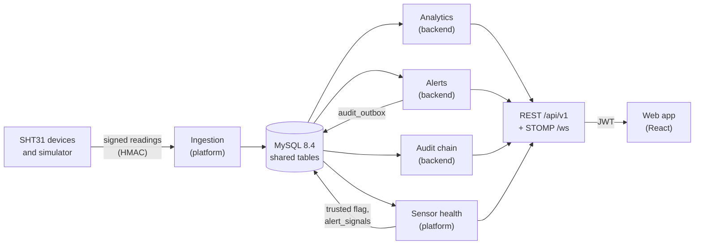

# Corrosion Watch

[](https://github.com/CS5010-team-404/corrosion-monitor/actions/workflows/ci.yml?query=branch%3Adev)

Corrosion Watch warns people before moisture damages electronic equipment. When warm, humid air meets a cooler surface,
water condenses on circuit boards and connectors and, over time, causes corrosion and failures that are expensive and
hard to trace. The system collects temperature and humidity readings from sensors (simulated SHT31 sensors, or an
optional Raspberry Pi with a real SHT31), checks that each sensor can be trusted, calculates the dew point, the
condensation margin and a corrosion risk index for every piece of equipment, and raises warning and critical alerts
that escalate to a manager if nobody responds. Every important action is written to a tamper-evident audit log.

**Live demo:** https://corrosion-watch-web.onrender.com

The detailed Phase 2 write-up is in [Phase2_README.md](Phase2_README.md).

## Contents

1. [Team](#team)
2. [How it works](#how-it-works)
3. [Repository structure](#repository-structure)
4. [Getting started](#getting-started)
5. [Running the tests](#running-the-tests)
6. [Try it end to end](#try-it-end-to-end)
7. [Project status](#project-status)
8. [Team contributions](#team-contributions)
9. [Development workflow](#development-workflow)
10. [Deployment](#deployment)
11. [Documentation](#documentation)
12. [Notes](#notes)

## Team

| Member           | GitHub                                           | Area                                                              |
|------------------|--------------------------------------------------|-------------------------------------------------------------------|
| Aayushee Bhat    | [@aayushee-bhat](https://github.com/aayushee-bhat) | Analytics: dew point margin, corrosion risk, equipment status       |
| Anela Quiroz     | [@anelajoy](https://github.com/anelajoy)           | Audit: hash-chained audit log and verification                     |
| Dumebi Onyebuchi | [@dumebi2003](https://github.com/dumebi2003)       | Alerts: alert lifecycle, escalation, corrective actions             |
| Joshua Dominick  | [@Joshuadommy](https://github.com/Joshuadommy)     | Data platform, sign-in, frontend and deployment                     |

## How it works



The system has the two parts from the Phase 1 design. The **data platform** (`platform/`) receives and checks sensor
data. The **team backend** (`backend/`) holds sign-in, analytics, alerts and audit. Both use one MySQL database.
Key design choices:

- **Services meet only through shared tables** ([docs/CONTRACTS.md](docs/CONTRACTS.md)). Neither calls the other.
- **Untrusted sensors are skipped.** Sensor health checks 7 rules (offline, stuck, out of range, erratic, losing
  readings, bad signatures, clock skew) and sets `sensor_health.trusted`. Analytics only uses readings from trusted
  sensors.
- **Signals instead of direct calls.** Producers write a RAISED or CLEARED row to `alert_signals`, and the alert
  service turns those into alerts.
- **A tamper-evident audit chain.** Events go to `audit_outbox` in the same transaction as the change they record.
  The audit worker chains them into `audit_log` with SHA-256, so editing, deleting or reordering any entry is detected.
- **One sign-in token for both services.** The backend issues a JWT that the platform also accepts.

[docs/ARCHITECTURE.md](docs/ARCHITECTURE.md) has the full picture.

## Repository structure

```
corrosion-monitor/
├── backend/                          Team backend: Spring Boot 3.4, Java 17
│   └── src/main/java/com/team404/corrosion/
│       ├── auth/                     Sign-in, lockout, JWT, demo users
│       ├── analytics/                Equipment status: dew point, margin, risk level (analytics/risk/: Peck index, time of wetness)
│       ├── alert/                    signal/ (consumer), lifecycle/ (REST, escalation, email), calculation/ (dew point)
│       ├── audit/                    Hash-chain worker, verification, checkpoints, audit API
│       ├── web/                      Security rules, error responses, WebSocket (/ws)
│       └── tools/                    Runs the Flyway migrations on their own (scripts/check-aiven.sh)
│   └── src/main/resources/db/migration/   Flyway migrations V1–V8 (the schema)
├── platform/                         Data platform, its own Maven build and service
│   ├── ecp-common/                   Dew point maths, HMAC signing, signal and audit publishers
│   ├── ecp-simulator/                Simulated SHT31 sensors, 10 scenarios
│   ├── ecp-forecast/                 Condensation forecaster (ML model, trainer)
│   ├── ecp-ingestion/                Signed device ingestion API
│   ├── ecp-health/                   Sensor health rules and API
│   └── ecp-platform-app/             Runnable service: security, device registry, simulator, forecast API
├── frontend/                         React 18 + TypeScript web app (8 pages, built-in mock backend)
├── simulator/                        Original Java sensor simulator (Maven module)
├── devices/raspberry-pi/             Optional real-sensor client
├── db/schema.sql                     Kept for reference only; Flyway creates the schema
├── deploy/platform.Dockerfile        Container image for the platform
├── scripts/                          Run, stop, test, deploy-check and model-training scripts
├── docs/                             Architecture, contracts, decisions, deployment, demo (see Documentation)
├── docker-compose.yml                Local MySQL 8.4 (production SQL settings) and MailHog
├── docker-compose.platform.yml       The above plus the platform service
├── render.yaml                       Render deployment blueprint
└── pom.xml                           Parent Maven build (backend and simulator)
```

Inside the backend, each area is layered the same way: **controllers** (REST) call **services** (rules and
transactions), which call **repositories** (JDBC, or JPA for users). For example, `AlertController` →
`AlertService` → `JdbcAlertStore`, and `EquipmentStatusController` → `AnalyticsService` → `JdbcAnalyticsRepo`.
The maths (dew point, Peck risk, time of wetness, alert states, hash chain) is plain Java with unit tests.

## Getting started

### Prerequisites

| Tool                 | Version                                    |
|----------------------|--------------------------------------------|
| JDK                  | 17 (what CI uses)                          |
| Maven                | 3.9                                        |
| Docker Desktop       | with Docker Compose v2                     |
| Node.js and npm      | Node 20 or newer (CI uses 22)              |
| Git                  | any recent version                         |

### One command

```bash
git clone https://github.com/CS5010-team-404/corrosion-monitor.git
cd corrosion-monitor
scripts/run-local.sh
```

This builds the jars if needed and starts:

| What                                   | Where                    |
|----------------------------------------|--------------------------|
| MySQL 8.4 (Docker, production SQL mode) | `localhost:3306`         |
| Team backend                           | http://localhost:8080    |
| Data platform (with the simulator)     | http://localhost:8081    |
| Web app                                | http://localhost:5173    |

It creates `.env.local` (ignored by git) with a local JWT secret and the demo password, and prints the demo emails.
Use `REBUILD=1 scripts/run-local.sh` after code changes. Stop everything with:

```bash
scripts/stop-local.sh            # keeps the database; `docker compose down -v` wipes it
```

### Manual path

```bash
cp .env.example .env                        # local database passwords; never commit .env
docker compose up -d                        # MySQL on 3306, MailHog inbox on http://localhost:8025

# Backend on :8080 (Flyway creates the schema on startup)
export MYSQL_USER=app_rw MYSQL_PASSWORD=change-me-app    # the values in your .env
export ECP_JWT_SECRET="$(openssl rand -base64 48)"       # required, at least 32 bytes
export ECP_DEMO_PASSWORD='choose-a-demo-password'        # password for the four demo users
mvn -B -pl backend -am -DskipTests package
java -jar backend/target/backend-0.1.0-SNAPSHOT.jar

# Data platform on :8081, in a second terminal (local mode, sign-in check off)
docker compose -f docker-compose.platform.yml up --build

# Web app on :5173, in a third terminal (proxies to :8080 and :8081)
cd frontend && npm install && npm run dev
```

### No Java: mock mode

```bash
cd frontend && npm install && npm run dev:mock
```

The whole UI runs on a built-in mock backend at http://localhost:5173. Sign in with a demo email and any password.

### Demo accounts

There is one account per role: `tech@corrosionwatch.app` (Technician), `operator@corrosionwatch.app` (Operator),
`manager@corrosionwatch.app` (Manager) and `admin@corrosionwatch.app` (Admin). Locally, the password is
`ECP_DEMO_PASSWORD` (`scripts/run-local.sh` puts it in `.env.local`). The live demo password is shared privately
with the instructor.

### Environment variables

Names and purpose only; never commit real values. `scripts/gen-secrets.sh` prints fresh values.

| Variable                                   | Used by  | Purpose                                                                     |
|--------------------------------------------|----------|-----------------------------------------------------------------------------|
| `MYSQL_ROOT_PASSWORD`                      | Docker   | Root password of the local MySQL container                                  |
| `MYSQL_USER`, `MYSQL_PASSWORD`             | Backend  | Database account (`app_rw` locally)                                         |
| `DB_URL`, `DB_POOL`                        | Backend  | JDBC URL (defaults to the local database) and connection pool size          |
| `ECP_JWT_SECRET`                           | Both     | Signs and checks sign-in tokens; at least 32 bytes, same value on both      |
| `ECP_DEMO_PASSWORD`, `ECP_DEMO_SEED`       | Both     | Password for the demo users; `ECP_DEMO_SEED=false` turns demo data off      |
| `ECP_ALERTS_*`                             | Backend  | Alert timings and switches, e.g. `ECP_ALERTS_SCHEDULER_ENABLED=false`      |
| `PORT`                                     | Both     | HTTP port (8080 backend, 8081 platform)                                     |
| `ECP_DB_URL`, `ECP_DB_USER`, `ECP_DB_PASSWORD`, `ECP_DB_POOL` | Platform | Database connection                                      |
| `ECP_PLATFORM_AUTH`                        | Platform | `jwt` (default) or `none` (local only)                                      |
| `ECP_SECRET_KEY`, `ECP_SECRET_SALT`        | Platform | Encrypt the device keys stored in the database                              |
| `ECP_SIMULATOR_ENABLED`, `ECP_SIMULATOR_SPEED` | Platform | Run the built-in simulator, and how fast its scenarios move           |
| `ECP_RETENTION_DAYS`                       | Platform | How long readings are kept                                                  |
| `SENSOR_SECRET`                            | Simulator | Signing key for the original simulator module                              |
| `VITE_API_URL`, `VITE_PLATFORM_URL`        | Web app  | Service URLs for a deployed build (empty locally: the dev proxy is used)    |
| `VITE_USE_MOCKS`, `VITE_BACKEND_LIVE`, `VITE_MOCK_FALLBACK` | Web app | Mock mode, live alert updates, sample data for missing endpoints |

## Running the tests

```bash
mvn -B verify                          # backend and simulator (needs Docker running for the MySQL tests)
mvn -B -f platform/pom.xml verify      # data platform, with a JaCoCo coverage report
cd frontend && npm install && npm run lint && npm test && npm run build
```

Results from a fresh clone of `dev` on 2026-11-08:

| Suite     | Command                             | Result                                                        |
|-----------|-------------------------------------|---------------------------------------------------------------|
| Backend   | `mvn -B verify`                     | `Tests run: 181, Failures: 0, Errors: 0, Skipped: 0`          |
| Platform  | `mvn -B -f platform/pom.xml verify` | 47 tests: common 7, simulator 7, forecast 6, health 18, app 9; 0 failures |
| Frontend  | `npm run lint`, `npm test`, `npm run build` | type check passes, `Tests 14 passed (14)`, build passes |

The backend's database tests run against MySQL 8.4 in Docker (Testcontainers) with the same SQL settings as
production. What the core tests cover:

| Area              | Tests                                                                                   |
|-------------------|-----------------------------------------------------------------------------------------|
| Dew point         | `DewPointTest` (backend) and `PsychrometricsTest` (platform) check the same reference values |
| Sensor health     | `HealthEvaluatorTest`, `HealthAssessmentTest`, `EpisodeTrackerTest`, `SimulatorToHealthTest` |
| Sign-in           | `LoginPolicyTest` and `AuthServiceLockoutTest` (lockout), `TokenServiceTest` and `TokenFixtureTest` (JWT), `AuthControllerTest` (endpoints and role rules), `BackendTokenCompatibilityTest` (platform accepts the token) |
| Schema            | `FlywayValidationTest`, `SharedSchemaMigrationTest`, `MigrateOnlyTest`, and `MigrationChecksumTest`, which fails if a migration already applied in production is edited |
| Alerts            | `SignalProcessorTest`, `SignalConsumerTest`, `AlertStatusTest`, `AlertLifecycleTest`, `AlertPushTest` |
| Audit             | `HashChainTest`, `ChainVerifierTest`, `AuditChainIntegrationTest`, `AuditViewsTest`      |
| Analytics         | `PeckRiskIndexTest`, `RiskAccumulatorTest`, `TimeOfWetnessTest`, `RiskClassifierTest`, `AnalyticsServiceTest`, `EquipmentStatusIntegrationTest` |
| Platform          | `HmacTest` (signatures), `SimulatedSensorTest`, `ForecastTest`                           |
| Frontend          | Error messages, formatting and thresholds, routing, unbuilt-endpoint handling, WebSocket reconnect |

## Try it end to end

### A failing sensor becomes an alert, a technician resolves it, the audit log records it

On the live demo (or locally after `scripts/run-local.sh`):

1. Sign in as `admin@corrosionwatch.app`.
2. Open **Administration → Simulator** and set **SIM-010** to **Silent**. The sensor stops sending readings.
3. Open **Alerts** and wait. After about 90 seconds (6 missed 15-second readings) sensor health marks SIM-010
   offline and untrusted, and a critical "Sensor offline: SIM-010" alert appears. The bell shows a dot, without a
   page reload.
4. Sign out and sign in as `tech@corrosionwatch.app`. Open the alert, click **Acknowledge**, log a corrective action
   with a note, then click **Resolve**. Each step appears in the alert's timeline.
5. Sign in as `manager@corrosionwatch.app` (or admin) and open **Audit log**. The alert's events are listed:
   opened, acknowledged, corrective action logged, resolved. As admin, **Verify chain** confirms the chain is intact.
6. As admin, set SIM-010 back to **Normal**.

If a page looks out of date after a new deployment, reload it without the cache (Cmd+Shift+R, or Ctrl+Shift+R).

### Sign-in and lockout

Try this locally, so the shared demo accounts are not locked. With `scripts/run-local.sh` running:

```bash
P="$(grep '^ECP_DEMO_PASSWORD=' .env.local | cut -d= -f2-)"
# 1. Correct password: 200 with a token, the role and an expiry time
curl -s -H 'Content-Type: application/json' -d "{\"email\":\"tech@corrosionwatch.app\",\"password\":\"$P\"}" \
  http://localhost:8080/api/v1/auth/login
# 2. Five wrong passwords: 401 "Incorrect email or password." four times, then 423 "Account locked ..."
for i in 1 2 3 4 5; do curl -s -o /dev/null -w '%{http_code}\n' -H 'Content-Type: application/json' \
  -d '{"email":"tech@corrosionwatch.app","password":"wrong"}' http://localhost:8080/api/v1/auth/login; done
# 3. The correct password is now refused too (423) until 15 minutes have passed
curl -s -o /dev/null -w '%{http_code}\n' -H 'Content-Type: application/json' \
  -d "{\"email\":\"tech@corrosionwatch.app\",\"password\":\"$P\"}" http://localhost:8080/api/v1/auth/login
```

The sign-in successes, failures and the lockout appear in the Audit log, with no passwords in them.

## Project status

The functional requirements from Phase 1 (wording and starting status from [Phase2_README.md](Phase2_README.md),
corrected where the code on `dev` shows otherwise):

| Requirement                                                                     | Status      | Notes |
|---------------------------------------------------------------------------------|-------------|-------|
| FR1: Read temperature and humidity from multiple sensors at adjustable intervals | Partial     | 12 simulated sensors (10 scenarios), a Raspberry Pi client and a signed ingestion API; sensor health with 7 rules. Each device has its own reporting interval (`expected_interval_s`, set when it is registered); it cannot be changed from the UI yet. |
| FR2: Forecast condensation 15–60 minutes ahead                                  | Partial     | Forecaster trained and evaluated ([docs/ML_FORECAST.md](docs/ML_FORECAST.md)) with a forecast API in the platform. The forecast fields in equipment status are still empty. |
| FR3: Warning and critical alerts, with escalation                               | Partial     | Sensor-health signals become alerts; a critical alert not acknowledged in 5 minutes escalates and emails the managers; live updates on `/topic/alerts`. Analytics does not raise condensation-risk signals yet. |
| FR4: Acknowledge alerts and record corrective actions                           | Done        | Acknowledge, resolve and corrective actions (type and notes), with a timeline in the UI. |
| FR5: Roles with enforced access levels                                          | Done        | Four roles. Rules are enforced on the server for every `/api/v1` path in both services (device ingestion is checked by its HMAC signature instead); refused audit requests are logged. User administration screens are not built yet (FR8). |
| FR6: Accurate audit log                                                         | Done        | SHA-256 hash chain, on-demand verification, nightly checkpoints, audit log page. |
| FR7: Export reports (CSV/PDF)                                                   | Not started | Planned for Phase 3. |
| FR8: Administrators configure equipment profiles and devices                    | Partial     | Device registry API and simulator controls; profiles with thresholds in the database (V8 adds kind, temperature range and surface offset). No screens to edit users, devices or profiles yet. |

Phase 1 listed three roles; the team agreed on four (Technician, Operator, Manager, Admin) in
[docs/DECISIONS.md](docs/DECISIONS.md). Missing pieces are tracked with owners in [docs/GAPS.md](docs/GAPS.md).

### Next steps (Phase 3)

- Analytics: the assessments endpoint (equipment history), forecast fields, and condensation-risk alert signals.
- Reports: CSV and PDF exports (FR7).
- Administration screens and APIs for users, equipment profiles and devices (FR8).
- Retrain the forecaster on a real dataset.
- Audit: keep checkpoints somewhere the application cannot write.
- First weekly release from `dev` to `main`, then security, sensor-failure and performance testing.
- Final documentation, NIST control mapping and evaluation results.

## Team contributions

Each paragraph is based on the commit history of `dev` and the merged pull requests.

**Aayushee Bhat (analytics).** Built the analytics service in
[backend/…/analytics](backend/src/main/java/com/team404/corrosion/analytics) and its endpoint
`GET /api/v1/equipment/status`: dew point and condensation margin, a Peck corrosion risk index against each
profile's risk budget, 24-hour time of wetness, and a status level from the profile's thresholds. Readings come
only from trusted sensors. Wrote the risk model classes (`PeckRiskIndex`, `RiskAccumulator`, `RiskClassifier`,
`TimeOfWetness`) with unit tests, an integration test against MySQL, and migration V8 (profile kind, temperature
range and surface offset). Pull request:
[#13](https://github.com/CS5010-team-404/corrosion-monitor/pull/13).

**Anela Quiroz (audit).** Built the audit service in
[backend/…/audit](backend/src/main/java/com/team404/corrosion/audit): the worker that chains `audit_outbox` events
into the SHA-256 hash-chained `audit_log`, verification against the chain head and saved checkpoints, nightly and
on-demand checkpoints, the SQL layer, and the role-checked audit API (managers read the log; only admins verify).
Wrote the audit migration V4, the audit tests, and the Phase 2 write-up ([Phase2_README.md](Phase2_README.md)).
Pull requests: [#5](https://github.com/CS5010-team-404/corrosion-monitor/pull/5),
[#6](https://github.com/CS5010-team-404/corrosion-monitor/pull/6) and
[#7](https://github.com/CS5010-team-404/corrosion-monitor/pull/7). The fixes in #7 reached `dev` through #10, a
squash merge that shows Joshua as author but contains Anela's two commits.

**Dumebi Onyebuchi (alerts).** Created the repository and its layout: the Maven project with backend and
simulator modules, the Spring Boot skeleton, Docker Compose, `.env.example`, the CI workflow on `dev` and `main`,
and the branch model in [CONTRIBUTING.md](CONTRIBUTING.md). Built the alert service in
[backend/…/alert](backend/src/main/java/com/team404/corrosion/alert): the consumer that turns `alert_signals` into
alerts, the lifecycle endpoints (list, detail, acknowledge, resolve, corrective actions), escalation of
unacknowledged critical alerts with an email to the managers, audit events and live updates on `/topic/alerts`,
the shared dew point calculation, and migrations V5–V7. Pull request:
[#8](https://github.com/CS5010-team-404/corrosion-monitor/pull/8).

**Joshua Dominick (data platform, sign-in, frontend, deployment).** Built the data platform in
[platform/](platform): the signed ingestion API, sensor health with 7 rules, the simulator with 12 devices and 10
scenarios, the condensation forecaster, and the device registry. Built sign-in in
[backend/…/auth](backend/src/main/java/com/team404/corrosion/auth) (BCrypt, lockout, JWT shared by both services,
four roles, demo users), moved the schema to Flyway (V1–V3) with the guard against editing applied migrations, and
built the web app in [frontend/](frontend) (8 pages, role-based navigation, live updates, mock mode). Set up
deployment on Render with Aiven MySQL ([render.yaml](render.yaml), Dockerfiles, CI for the platform and frontend,
[scripts/](scripts)). Pull requests: [#4](https://github.com/CS5010-team-404/corrosion-monitor/pull/4),
[#9](https://github.com/CS5010-team-404/corrosion-monitor/pull/9),
[#11](https://github.com/CS5010-team-404/corrosion-monitor/pull/11) and
[#12](https://github.com/CS5010-team-404/corrosion-monitor/pull/12).

## Development workflow

- Branches: `feature/<name>-<topic>` (or `fix/`, `docs/`) from `dev`, merged back into `dev` by pull request.
  `main` changes only through the weekly release from `dev`.
- Every pull request needs one teammate's approval and a green CI check.
- Migrations are never edited once merged, not even their comments. A schema change goes in a new
  `V<n>__description.sql`. `MigrationChecksumTest` enforces this for migrations applied in production.
- Never commit secrets, `.env` files or real passwords.

Details are in [CONTRIBUTING.md](CONTRIBUTING.md).

## Deployment

The live demo runs on Render as three services from [render.yaml](render.yaml): the team backend
(`corrosion-watch-api`, Docker), the data platform (`corrosion-watch-platform`, Docker) and the web app
(`corrosion-watch-web`, static site). They share an Aiven MySQL 8.4 database. See
[docs/DEPLOYMENT.md](docs/DEPLOYMENT.md).

## Documentation

| File                                                                 | What it covers                                            |
|----------------------------------------------------------------------|-----------------------------------------------------------|
| [Phase2_README.md](Phase2_README.md)                                 | Detailed Phase 2 write-up                                 |
| [docs/ARCHITECTURE.md](docs/ARCHITECTURE.md)                         | System design, services and ownership                     |
| [docs/CONTRACTS.md](docs/CONTRACTS.md)                               | Shared tables, endpoints and topics between services      |
| [docs/DECISIONS.md](docs/DECISIONS.md)                               | Team decisions (API prefix, roles, Flyway, versions)      |
| [docs/GAPS.md](docs/GAPS.md)                                         | What is still missing, with owners                        |
| [docs/REQUIREMENTS_TRACEABILITY.md](docs/REQUIREMENTS_TRACEABILITY.md) | Where each proposal requirement is met                  |
| [docs/1-api-contract.md](docs/1-api-contract.md)                     | Original API contract (v1)                                |
| [docs/SENSOR_HEALTH.md](docs/SENSOR_HEALTH.md)                       | Sensor health rules                                       |
| [docs/ML_FORECAST.md](docs/ML_FORECAST.md)                           | Condensation forecaster                                   |
| [docs/ml-training-report.md](docs/ml-training-report.md)             | Forecaster training report                                |
| [docs/4-simulator-design.md](docs/4-simulator-design.md)             | Sensor simulator design                                   |
| [docs/DEPLOYMENT.md](docs/DEPLOYMENT.md)                             | Render and Aiven deployment                               |
| [docs/DEMO.md](docs/DEMO.md)                                         | Four-minute demo script                                   |
| [docs/REPO_MAP.md](docs/REPO_MAP.md)                                 | Snapshot of the repository from the start of Phase 2      |
| [docs/ui-design.html](docs/ui-design.html)                           | UI design reference                                       |
| [devices/raspberry-pi/README.md](devices/raspberry-pi/README.md)     | Setting up a real SHT31 sensor                            |
| [CONTRIBUTING.md](CONTRIBUTING.md)                                   | Branch model and pull request rules                       |

## Notes

- The design is aligned with selected NIST SP 800-53 controls and the NIST CPS Framework. It is not certified or
  compliant.
- Data from the simulator is labelled as simulated wherever it appears.
- Never commit passwords, sensor keys, tokens or `.env` files.
